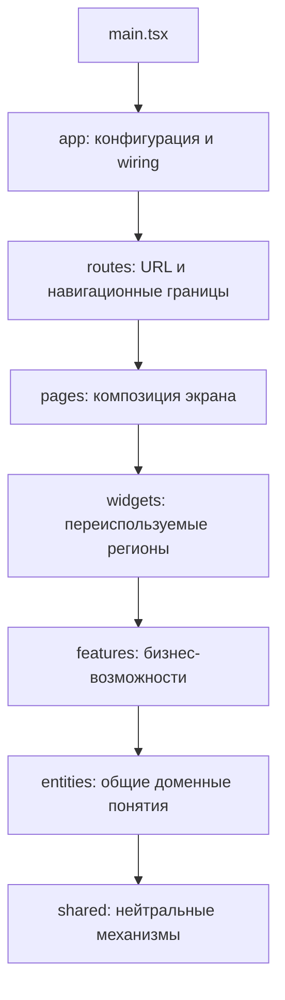

# Архитектура приложения

Область документа и версии исходников указаны в [оглавлении](./README.md). Практические примеры из `main` связаны с конкретным commit; пути starter относятся к исходному состоянию шаблона.

## Основная модель

Проект использует feature-folder architecture: одна бизнес-возможность объединяет свои UI, запросы, модели, преобразования и тесты. Вертикальный срез позволяет понять и изменить сценарий без обхода всех технических папок приложения.

Горизонтальные слои ограничивают зависимости между такими срезами. Это прагматичная архитектура с принципами Clean Architecture; она не требует отдельного repository, service, entity и DI-интерфейса для каждого запроса и не является строгой реализацией всех правил Feature-Sliced Design.

Четыре цели определяют решения:

- **Связность:** код, меняющийся по одной бизнес-причине, расположен рядом.
- **Слабое зацепление:** потребители знают минимальный публичный контракт модуля.
- **Явные зависимости:** инфраструктура создаётся централизованно, взаимодействия видны в типах, props и callbacks.
- **Заменяемость:** фичу можно заменить или удалить без переписывания независимых возможностей.

## Слои и направление импортов



Диаграмма задаёт порядок слоёв, а не обязательную цепочку каждого импорта: page может обращаться напрямую к feature и shared. Зависимости идут вниз. `entities` зависит только от `shared`; `shared` не знает продуктовых сущностей и верхних слоёв. Отдельная согласованная граница — использование настроенного HTTP-клиента feature API-адаптером, описанное ниже.

### main и app

`main.tsx` монтирует приложение и собирает верхние providers. `app` владеет конфигурацией и созданием конкретных технических зависимостей.

В starter:

- `app/config/env.ts` валидирует публичные Vite-параметры.
- `app/di/api-client.ts` создаёт HTTP-клиент и передаёт настройку mock.
- `app/di/query-client.ts` создаёт QueryClient с общей политикой обработки ошибок и retry.
- `app/di/router.ts` содержит единственную фабрику router; тесты могут передать memory history.
- `main.tsx` создаёт один QueryClient и router, подключает `StrictMode`, тему, Query provider и Router provider.

Это composition root: конкретные реализации собираются здесь, а не создаются заново при render каждого компонента. Не нужен DI-framework, если достаточно обычных TypeScript-функций и фабрик.

Feature API по правилам проекта может импортировать настроенный `apiClient` из `app/di`. Это узкая инфраструктурная граница, а не разрешение импортировать произвольную конфигурацию приложения в доменные правила. Сам `shared/api/client.ts` не должен импортировать `app`, auth или другие фичи.

### routes

Маршрут владеет URL, params, проверкой search, guard, loader, pending/error/not-found boundaries. Leaf route выбирает page; root и pathless layout могут собирать общую оболочку.

В starter `routes/examples.tsx` валидирует search и отображает `ExamplesPage`. В `main` маршрут MCP Registry передаёт `Route.useSearch()` в page через props. Оба способа допустимы: page может читать типизированные router APIs либо принимать уже проверенные значения.

`src/routeTree.gen.ts` генерируется плагином/CLI. Его нельзя править вручную. Vite включает file-based routing и `autoCodeSplitting`; отдельную систему маршрутизации вводить не нужно.

### pages

Page — владелец конкретного экрана: заголовка, основной области, боковых панелей и диалогов. Он связывает соседние фичи и адаптирует навигацию в callbacks.

Пример: [McpServerRegistryPage в main](https://github.com/abraxas93/react-template/blob/a87ce5951be3000342e8fc767012b7a0c7505eed/src/pages/mcp-server-registry-page.tsx) явно собирает header, список, добавление и запуск сервера. Его controller объединяет URL, queries, mutations и локальное открытие диалога. Бизнес-решение о необходимости credentials остаётся в feature hook.

Page не вызывает raw API и не становится владельцем серверных данных. Небольшая page, отображающая одну цельную фичу, допустима: искусственные обёртки ради размера файла не нужны.

### widgets

Widget — значимый переиспользуемый UI-регион, иногда объединяющий несколько фич. В starter это `application-shell`: общий header, навигация и область контента.

Widget владеет композицией региона. Он не должен присваивать себе бизнес-правила фич. Размер JSX сам по себе не делает компонент widget.

Размещайте общие ограничения ширины, scroll, отступов и responsive-структуры у ближайшего общего владельца. Не компенсируйте несовместимые layout-контракты отрицательными margins в каждом дочернем компоненте.

### features

Feature представляет пользовательскую возможность: просмотреть историю диалогов, запустить MCP-сервер, подтвердить аккаунт встречи, подготовить briefing.

Внутри неё могут находиться:

- `api/` и `api/dto/` — endpoint adapters, транспортные схемы и runtime mocks;
- `components/` — UI сценария;
- `hooks/` — React-адаптация и orchestration;
- `models/` — модели, чистые правила и определения состояния;
- `mappers/` — преобразования между транспортом, доменом и представлением;
- `services/` — самостоятельные workflows/use cases;
- `validation/` — схемы ввода;
- `lib/` — конкретно названные приватные helpers;
- `index.ts` — внешний контракт.

Папки создаются по потребности. Starter `example-catalog` не требует service или mapper: адаптер возвращает уже подходящую модель. В `main/threads` mapper полезен: `_id` превращается в `id`, а необязательные transport-поля получают deliberate application semantics.

### entities

Entity содержит доменное понятие, необходимое нескольким фичам: например, Meeting, Source или Artifact в `main`. Это не обязательный класс и не автоматическая копия backend-таблицы.

Общие типы и чистые правила помещаются в минимальный общий слой. Entity не импортирует feature DTO или feature hooks. Если сущность читают извне, нужен root `index.ts`.

В starter слоя `entities` нет: общая предметная область ещё не возникла. Создавать пустую папку заранее не требуется.

### shared

Здесь расположены доменно-нейтральные механизмы: HTTP transport, общие технические ошибки, `cn`, переиспользуемые hooks и UI-примитивы.

Бизнес-specific endpoint и DTO остаются в feature, даже если ими пользуются несколько компонентов этой же фичи. Повторение кода внутри одной capability не делает его shared.

`shared/config` допустим для общих технических констант с реальными независимыми потребителями. Параметры окружения принадлежат `app/config`, бизнес-настройки — своей feature.

## Публичные контракты

Внешний потребитель импортирует feature/widget через root `index.ts`:

```ts
import { ExampleCatalog } from "#/features/example-catalog";
import { ApplicationShell } from "#/widgets/application-shell";
import { Button } from "@/components/ui/button";
```

Алиасы важны: `#/*` означает `src/*`, `@/*` — только `src/shared/*`. Поэтому буквальные `@/features/...` из абстрактных примеров в `AGENTS.md` не соответствуют реальному `tsconfig.json`.

Не импортируйте чужие `components`, DTO или store internals обходным путём. Внутри своего модуля используйте прямые относительные импорты. Экспортируйте только реально поддерживаемую внешнюю поверхность, без автоматического `export *`.

Фичи предпочтительно координировать в page/widget через значения и callbacks. Обоснованная прямая feature-зависимость разрешена через публичный API и должна оставаться односторонней и ацикличной. Глобальный event bus не является стандартным решением.

## Маршрутизация и общая загрузка данных

Loader нужен, когда данные необходимы до отображения или предварительная загрузка заметно улучшает переход. Он не обязателен для каждого query.

В [loader встречи в main](https://github.com/abraxas93/react-template/blob/a87ce5951be3000342e8fc767012b7a0c7505eed/src/routes/_app/meetings/-meeting-details-route.loader.ts) используется `queryClient.ensureQueryData(meetingDetailsQueryOptions(meetingId))`. Page затем читает тот же query. Это один кэш, а не два параллельных источника server state. HTTP 404 преобразуется в router `notFound`, остальные ошибки передаются дальше.

При адаптации этого подхода к starter нужно явно передать тот же QueryClient в router context. В исходном starter контекст с QueryClient не задан, поскольку `/examples` загружает данные через feature hook без loader.

Search проверяется на route boundary. Если он определяет loader-запрос, задайте `loaderDeps`. Guard `beforeLoad` отвечает за предпосылки перехода, а не обычную загрузку экрана. В `main` `_app` — pathless authenticated layout; в starter авторизации и такого layout нет.

## Границы main и starter

Не все детали большого приложения следует переносить в шаблон:

1. **Настроенный HTTP-клиент.** В `main/shared/api/api-client.ts` wiring зависит от auth store и toast. Это нарушает нейтральность shared. В starter concrete client уже находится в `app/di/api-client.ts`; новый код должен следовать этой границе.
2. **Окружение.** В `main` настройки находятся в `shared/lib/env.ts`. В starter они уже перенесены в `app/config/env.ts` и передаются request builder через constructor options.
3. **Авторизация.** `main` реализует cookie credentials, refresh и обработчики authentication failures. Starter не содержит auth-провайдера, refresh endpoint и cookie-политики. Добавлять их можно только под реальный backend-контракт.
4. **Zustand.** В `main` есть глобальный auth store; это не образец page-scoped store. В starter Zustand не установлен. Для простого экрана достаточно URL, Query и локального состояния.
5. **Services.** `reviewPreCallBrief` в `main` — полезный пример workflow с проверками, но напрямую импортирует API-функции и тестируется module mocks. Для нового workflow с необходимостью подмены зависимостей правило проекта предпочитает явные узкие зависимости.
6. **SSE.** В `main` добавлен stream transport; starter поддерживает обычные request/response и не содержит `apiClient.stream`. Детали этого отдельного контракта разобраны в [сценариях](./main-examples.md#поток-ответов-агента).

Это описание различий, а не предложение мигрировать весь `main` в рамках работы над шаблоном. Новые изменения должны сохранять границы, а найденные старые отклонения не следует расширять.

## Где смотреть исходники

- [Composition root starter](https://github.com/abraxas93/react-template/blob/7438bc6075fe6c32a9743c718109def39a4c459a/src/main.tsx).
- [HTTP wiring starter](https://github.com/abraxas93/react-template/blob/7438bc6075fe6c32a9743c718109def39a4c459a/src/app/di/api-client.ts).
- [MCP feature public API main](https://github.com/abraxas93/react-template/blob/a87ce5951be3000342e8fc767012b7a0c7505eed/src/features/mcp-server-registry/index.ts).
- [Meeting page main](https://github.com/abraxas93/react-template/blob/a87ce5951be3000342e8fc767012b7a0c7505eed/src/pages/meeting-details-page/index.tsx).
- [Meeting entity main](https://github.com/abraxas93/react-template/blob/a87ce5951be3000342e8fc767012b7a0c7505eed/src/entities/meeting/models/meeting.ts).
