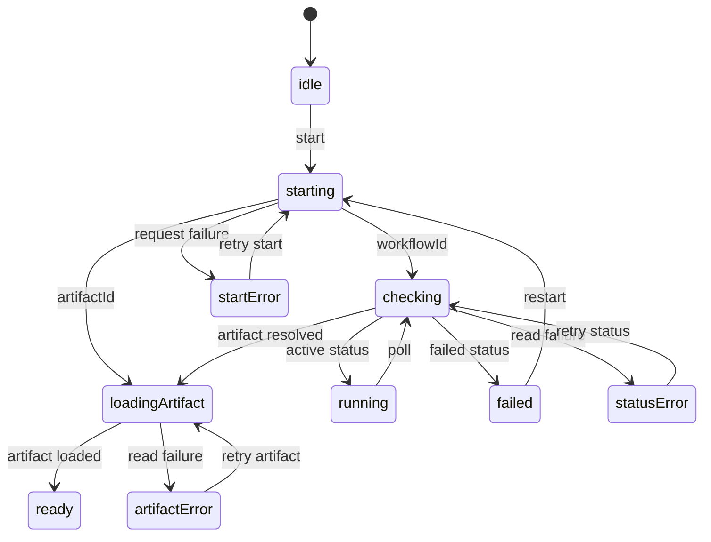

# Разбор реальных сценариев main

Все исходники в этом документе относятся к `main` на commit `a87ce5951be3000342e8fc767012b7a0c7505eed`. Эти фичи отсутствуют в исходном starter; ссылки ведут на закреплённую версию приложения. Для переноса подхода используйте границы из [архитектуры](./architecture.md), а не механическое копирование модулей.

## MCP Registry: URL, preferences и диалоги

Пользователь фильтрует реестр, выбирает представление, добавляет и запускает серверы. Здесь достаточно нескольких источников состояния без отдельного page store.

### Владельцы

- Route проверяет `status`, `state`, `search`, а middleware удаляет defaults из URL.
- `useMcpServersQuery` владеет server list; query options задают `staleTime: 30_000`.
- Page controller владеет transient открытием add dialog и адаптирует navigation/mutation actions.
- Вид `list`/`grid` сохраняется отдельной localStorage preference.
- `useMcpServerRunWorkflow` хранит выбранный server ID и решает, нужен ли credentials dialog.
- Mutation hooks выполняют transport и согласуют кэш.

`McpServerRegistryPage` явно отображает header, list и два dialogs. Page-private header расположен у page; feature-specific list и dialogs импортируются из feature public API. Это позволяет видеть структуру экрана, не превращая page в набор технических запросов.

### Запуск сервера

`requestRun(serverId)` находит сервер в актуальном списке. Если credentials нужны, hook открывает диалог; иначе вызывает run mutation сразу. Полный объект сервера не копируется в локальный state: `dialogServer` вычисляется по ID.

В workflow нет router, а page не повторяет `serverNeedsCredentials`. Повторная feature-specific операция копирования endpoint выделена в `useCopyMcpServerEndpoint`: browser clipboard и сообщения о результате остаются рядом с feature-взаимодействием.

Общий helper `useMcpMutation` находится внутри этой feature, поскольку имеет одинаковую семантику уведомлений и invalidation. Наличие нескольких похожих mutations не требует универсального «mutation framework» в shared.

### Что переносить в starter

Переносимая идея — разделить URL, server cache, preference и transient UI по владельцам. Page controller нужен при реальной координации, а не для обязательной обёртки каждой page. Query statuses и data он возвращает как адаптацию существующего Query state.

Исходники:

- [Route](https://github.com/abraxas93/react-template/blob/a87ce5951be3000342e8fc767012b7a0c7505eed/src/routes/_app/mcp-server-registry/index.tsx).
- [Page и её регионы](https://github.com/abraxas93/react-template/blob/a87ce5951be3000342e8fc767012b7a0c7505eed/src/pages/mcp-server-registry-page.tsx).
- [Page controller](https://github.com/abraxas93/react-template/blob/a87ce5951be3000342e8fc767012b7a0c7505eed/src/pages/mcp-server-registry-page/use-mcp-server-registry-page-controller.ts).
- [Run workflow](https://github.com/abraxas93/react-template/blob/a87ce5951be3000342e8fc767012b7a0c7505eed/src/features/mcp-server-registry/hooks/use-mcp-server-run-workflow.ts).
- [Mutations и optimistic delete](https://github.com/abraxas93/react-template/blob/a87ce5951be3000342e8fc767012b7a0c7505eed/src/features/mcp-server-registry/hooks/use-mcp-mutations.ts).
- [Integration tests](https://github.com/abraxas93/react-template/blob/a87ce5951be3000342e8fc767012b7a0c7505eed/src/pages/mcp-server-registry-page.integration.test.tsx).

## История диалогов: транспорт, mapper и optimistic write

Этот сценарий показывает полноценную boundary на относительно небольшой feature.

`getThreadsList` вызывает `/v1/threads`, проверяет envelope `{ data, error: null }`, затем применяет `mapThreadSummary`. Runtime mock подключён непосредственно к request. Parsed DTO содержит `Date`; application model дополнительно скрывает `_id` и необязательные transport-поля.

`useThreadsQuery` использует feature key и freshness 30 секунд. `filterThreads` остаётся чистым правилом; список не нужно держать одновременно в Query и local state.

`deleteThread` кодирует ID в URL и проверяет не только HTTP-успех, но и `deletedCount === 1`. Это известная endpoint-specific семантика, которую transport общего назначения определить не может.

`useDeleteThread` управляет optimistic removal, rollback и invalidation. UI не вызывает API напрямую и не повторяет правила кэша. Это полезный образец для обычного удаления, но concurrent mutations требуют отдельного анализа snapshot rollback, как описано в [дизайне данных](./code-design.md#mutations-и-согласование-кэша).

Исходники:

- [Adapters](https://github.com/abraxas93/react-template/blob/a87ce5951be3000342e8fc767012b7a0c7505eed/src/features/threads/api/threads.api.ts).
- [Response schema](https://github.com/abraxas93/react-template/blob/a87ce5951be3000342e8fc767012b7a0c7505eed/src/features/threads/api/dto/threads-list.dto.ts).
- [Mapper](https://github.com/abraxas93/react-template/blob/a87ce5951be3000342e8fc767012b7a0c7505eed/src/features/threads/mappers/map-thread-summary.ts).
- [Delete mutation](https://github.com/abraxas93/react-template/blob/a87ce5951be3000342e8fc767012b7a0c7505eed/src/features/threads/hooks/use-delete-thread.ts).
- [Hook tests](https://github.com/abraxas93/react-template/blob/a87ce5951be3000342e8fc767012b7a0c7505eed/src/features/threads/hooks/threads-hooks.test.tsx).

## Детали встречи: loader и чистая projection

Экран связывает встречу, аккаунт, transcript, pre-call brief и post-call analysis. Если поместить все условия в JSX, правила выбора UI смешаются с router и запросами.

Реализация разделяет четыре обязанности:

1. Route loader обеспечивает наличие meeting query data; HTTP 404 превращается в router not-found.
2. Page controller получает данные, время, requested view и generation hooks; адаптирует их в узкие входы.
3. `deriveMeetingDetailsProjection` чисто вычисляет `phase`, доступные views, header и `body.kind`.
4. Page и page-private body components отображают нужные регионы.

### Почему projection принадлежит feature

Функция учитывает бизнес-смысл: cancelled meeting, confirmed account, временное окно, transcript и результаты workflows. Эти правила могут использоваться вне одной JSX-композиции, поэтому находятся в `features/meeting-details/models`.

`now: Date` передаётся аргументом, что делает выбор future/in-progress/past детерминированным в тестах. React hook `useMeetingBoundaryTime` отвечает за изменение времени на границах встречи; pure model не вызывает browser timers.

Результат — union по `body.kind`, включая `account-confirmation`, `pre-call-ready`, `workflow-processing`, `artifact-loading`, `pre-call-artifact`, `post-call-artifact`, `inconsistent-data` и другие состояния. Ветвление UI опирается на явный контракт.

### Неоднозначность и восстановление

Несколько подходящих артефактов или активных workflows не разрешаются произвольным выбором первого. Projection возвращает inconsistent-data, поскольку контракт выбора не определён. Это лучше показывает отсутствующую семантику, чем случайно связывает документ с неверным workflow.

Controller координирует pre-call и post-call через их публичные APIs. Page-local adapters переводят их статусы в узкий `MeetingDetailsViewState` без Query objects и feature-specific artifact content. Query data не копируются в store.

`remountDeps` маршрута привязан к `meetingId`: переход к другой встрече пересоздаёт page scope. Controller при необходимости канонизирует `?view=` через router navigation. Background refresh failure показывает предупреждение рядом с уже доступными данными.

Исходники:

- [Meeting route](https://github.com/abraxas93/react-template/blob/a87ce5951be3000342e8fc767012b7a0c7505eed/src/routes/_app/meetings/%24meetingId.tsx).
- [Loader](https://github.com/abraxas93/react-template/blob/a87ce5951be3000342e8fc767012b7a0c7505eed/src/routes/_app/meetings/-meeting-details-route.loader.ts).
- [Page controller](https://github.com/abraxas93/react-template/blob/a87ce5951be3000342e8fc767012b7a0c7505eed/src/pages/meeting-details-page/use-meeting-details-page-controller.ts).
- [Projection и правила выбора](https://github.com/abraxas93/react-template/blob/a87ce5951be3000342e8fc767012b7a0c7505eed/src/features/meeting-details/models/derive-meeting-details-projection.ts).
- [Projection tests](https://github.com/abraxas93/react-template/blob/a87ce5951be3000342e8fc767012b7a0c7505eed/src/features/meeting-details/models/derive-meeting-details-projection.test.ts).

## Генерация артефакта: command, polling и результат

Запустить генерацию, дождаться backend workflow и загрузить документ — разные операции с разными failure modes. HTTP success старта ещё не означает, что артефакт готов.

`usePreCallBriefGeneration` объединяет mutation старта, query статуса и query артефакта. Server-owned результаты остаются внутри Query/Mutation, а UI-state вычисляется из них.

Это упрощённая схема основного пути: реализация также проверяет inconsistent-data и умеет восстанавливаться из server-provided workflow/artifact IDs без нового старта.

### Принципиальные детали

- `startInFlightRef` блокирует второй синхронный запуск до обновления mutation status. Это локальная защита, не backend-idempotency.
- Start mutation использует `retry: false`: автоматическое повторение command не предполагается безопасным.
- Polling активного workflow идёт с интервалом по умолчанию 2 секунды; при ошибке прекращается. Terminal states не продолжают polling.
- Если ответ содержит artifact ID, запускается чтение документа. Если workflow завершён без ID, meeting details перечитываются и проверяется ровно один соответствующий artifact.
- Workflow проверяется на правильный тип `M01` и, когда meeting ID присутствует, на принадлежность нужной встрече.
- `retryStatusCheck` повторяет статус существующего workflow, `retryArtifact` повторяет чтение документа, а `start` — только допустимый новый запуск.

Так UI не отправляет новый command только потому, что временно не удалось прочитать статус. Общий `workflow-run` feature также предоставляет reusable query/options и progress model, но конкретная pre-call генерация владеет своим reconciliation.

Исходники:

- [Generation hook](https://github.com/abraxas93/react-template/blob/a87ce5951be3000342e8fc767012b7a0c7505eed/src/features/pre-call-brief/hooks/use-pre-call-brief-generation.ts).
- [Generation state union](https://github.com/abraxas93/react-template/blob/a87ce5951be3000342e8fc767012b7a0c7505eed/src/features/pre-call-brief/models/pre-call-brief-generation.ts).
- [Reusable workflow query](https://github.com/abraxas93/react-template/blob/a87ce5951be3000342e8fc767012b7a0c7505eed/src/features/workflow-run/hooks/use-workflow-run-query.ts).
- [Post-call generation tests](https://github.com/abraxas93/react-template/blob/a87ce5951be3000342e8fc767012b7a0c7505eed/src/features/post-call-analysis/hooks/use-post-call-analysis-generation.test.tsx).

## Подтверждение актуальной версии документа

`reviewPreCallBrief` показывает, когда service/use case имеет самостоятельный смысл:

1. Загружает backend-представление brief по meeting/artifact IDs.
2. Берёт последнюю версию, а при её отсутствии завершает операцию ошибкой.
3. Проверяет соответствие meeting ID у artifact, meeting и version payload.
4. Передаёт исходный backend payload в сохранение review вместе с notes, если они заданы.

Review не восстанавливается из view model. UI-модель могла потерять backend-поля или изменить их смысл, поэтому для записи используется проверенный актуальный payload.

Service не зависит от React. Однако в этой версии он напрямую импортирует API-функции; тесты подменяют их через `vi.mock`. Если новый workflow требует явной подмены или нескольких adapters, предпочтительны consumer-owned узкие порты и wiring на уровне приложения. Не нужно копировать прямые импорты как обязательный стиль DI.

Чтение последней версии перед write само по себе не доказывает атомарность и не предотвращает конкурентное изменение на backend между read и write. Такой контракт требует отдельной серверной поддержки и здесь не предполагается.

Исходники: [service](https://github.com/abraxas93/react-template/blob/a87ce5951be3000342e8fc767012b7a0c7505eed/src/features/pre-call-brief/services/review-pre-call-brief.ts), [проверка payload и meeting ownership](https://github.com/abraxas93/react-template/blob/a87ce5951be3000342e8fc767012b7a0c7505eed/src/features/pre-call-brief/services/review-pre-call-brief.test.ts).

## Поток ответов агента

В `main` assistant-chat adapter предоставляет `streamAgent(sessionId, { signal })` как `AsyncGenerator<AgentStreamEvent>`. Транспорт `apiClient.stream` возвращает Response body, а feature adapter знает SSE events конкретного backend.

Parser накапливает неполные chunks, разделяет frames по пустой строке, поддерживает LF/CRLF и многострочный `data`. Feature-specific Zod schemas валидируют JSON events, затем они преобразуются в union: message, tool-call, tool-response, references, questions, complete и error. Неизвестное событие вызывает ошибку.

Этот контракт отличается от обычного `.response(schema)` request: поток проверяется по событиям. В starter такого метода клиента нет; нельзя использовать этот API без добавления transport boundary и подтверждения streaming-контракта.

Это пример размещения transport и feature parsing, а не готовая гарантия надёжности всего chat workflow. Реализация не определяет reconnect/replay policy и не содержит `finally` с явным освобождением reader. При развитии потока нужно отдельно обеспечить его lifecycle, отмену и обработку оборванного ответа. Данный adapter не доказывает, что поток уже подключён к видимому chat UI.

Также SSE schemas пока объявлены внутри `stream-agent.api.ts`, хотя правила нового кода требуют feature-specific DTO schemas в `api/dto`. Полезная идея здесь — типизированная граница событий; размещение схем не следует воспроизводить как нормативное.

Исходники: [stream adapter](https://github.com/abraxas93/react-template/blob/a87ce5951be3000342e8fc767012b7a0c7505eed/src/features/assistant-chat/api/stream-agent.api.ts), [HTTP streaming transport](https://github.com/abraxas93/react-template/blob/a87ce5951be3000342e8fc767012b7a0c7505eed/src/shared/api/client.ts), [API tests](https://github.com/abraxas93/react-template/blob/a87ce5951be3000342e8fc767012b7a0c7505eed/src/features/assistant-chat/api/assistant-chat.api.test.ts).
